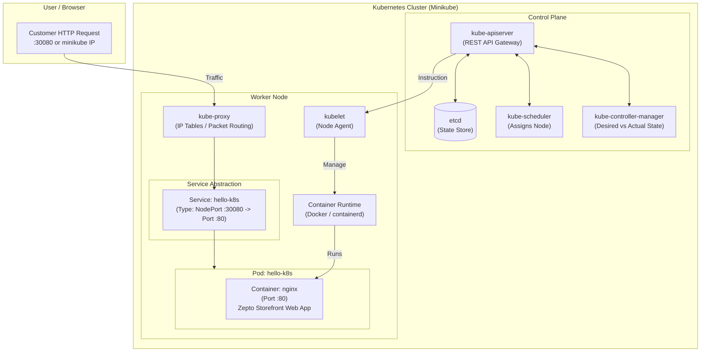

# Exercise 01: Hello Pod (Zepto Storefront)

## 📌 Business Scenario (Zepto)
Imagine you are a DevOps Engineer at **Zepto**. The product engineering team has built a lightweight web application serving as the customer storefront and live order-delivery tracking page.

Your task is to containerize and deploy this application on **Kubernetes (K8s)** so that:
1. It is portable across local, staging, and production environments.
2. It can be monitored, health-checked, and self-healed by the cluster.
3. It can be exposed to traffic and scaled horizontally in later phases.

For this initial milestone, we simulate the Zepto storefront using the official `nginx` container image.

---

## 🏗️ Architecture & Kubernetes Internals



---

## ⚙️ Prerequisites & Setup

### 1. Install Minikube & Kubectl
- **Windows (PowerShell as Administrator)**:
  ```powershell
  choco install minikube kubernetes-cli
  ```
- **WSL (Ubuntu / Debian Linux)**:
  ```bash
  sudo apt-get update -y
  sudo apt-get install -y curl apt-transport-https virtualbox virtualbox-ext-pack
  curl -LO https://storage.googleapis.com/minikube/releases/latest/minikube-linux-amd64
  sudo install minikube-linux-amd64 /usr/local/bin/minikube
  ```
- **macOS (Homebrew)**:
  ```bash
  brew install minikube kubectl
  ```

### 2. Start the Cluster
```bash
minikube start
```
Check status:
```bash
minikube status
kubectl cluster-info
```

---

## 🚀 Deployment Options

### Method A: Imperative Approach (Quick CLI Testing)

1. **Run the Nginx Pod**:
   ```bash
   kubectl run hello-k8s --image=nginx --port=80
   ```

2. **Verify Pod Status**:
   ```bash
   kubectl get pods -o wide
   ```

3. **Expose as a NodePort Service**:
   ```bash
   kubectl expose pod hello-k8s --type=NodePort --port=80
   ```

4. **Access the Application**:
   ```bash
   minikube service hello-k8s
   ```
   *(or port-forward: `kubectl port-forward pod/hello-k8s 8080:80` and open `http://localhost:8080`)*

---

### Method B: Declarative Approach (Production GitOps Standard)

Manifest files are located in [`manifests/`](./manifests):

1. **Review Pod Specification** ([`pod.yaml`](./manifests/pod.yaml)):
   ```yaml
   apiVersion: v1
   kind: Pod
   metadata:
     name: hello-k8s
     labels:
       app: hello-k8s
       tier: frontend
       project: zepto-storefront
   spec:
     containers:
       - name: nginx
         image: nginx:latest
         ports:
           - containerPort: 80
             name: http
         resources:
           requests:
             memory: "64Mi"
             cpu: "50m"
           limits:
             memory: "128Mi"
             cpu: "100m"
   ```

2. **Review Service Specification** ([`service.yaml`](./manifests/service.yaml)):
   ```yaml
   apiVersion: v1
   kind: Service
   metadata:
     name: hello-k8s
     labels:
       app: hello-k8s
   spec:
     type: NodePort
     selector:
       app: hello-k8s
     ports:
       - protocol: TCP
         port: 80
         targetPort: 80
         nodePort: 30080
   ```

3. **Apply Manifests**:
   ```bash
   kubectl apply -f manifests/pod.yaml
   kubectl apply -f manifests/service.yaml
   ```

4. **Automated Scripts**:
   - Linux/WSL/macOS: `./scripts/deploy.sh`
   - Windows PowerShell: `.\scripts\deploy.ps1`

---

## 🔍 Verification & Inspection

```bash
# 1. Check Pod details and status
kubectl get pods -l app=hello-k8s

# 2. Inspect events and container state
kubectl describe pod hello-k8s

# 3. Check live web server logs
kubectl logs hello-k8s -f

# 4. Check Service binding and endpoints
kubectl get svc hello-k8s
kubectl get endpoints hello-k8s
```

---

## 🔬 Kubernetes Internals Explained

1. **What happens during `kubectl run` or `kubectl apply`?**
   - The CLI converts the command/manifest into a JSON payload sent to `kube-apiserver`.
   - The API server authenticates and validates the request, writing the desired state to `etcd`.
   - `kube-scheduler` detects the unscheduled Pod and selects a suitable worker node based on resource availability.
   - The `kubelet` on that worker node receives the instruction, communicates with the Container Runtime (`containerd`/Docker) via CRI (Container Runtime Interface), pulls the `nginx` image, and starts the container.
   - `kubelet` monitors container health and reports status back to `kube-apiserver`.

2. **Why do we need a Service?**
   - Pods are ephemeral: when restarted or rescheduled, they receive a new internal IP address.
   - A `Service` provides a stable IP address and DNS name, routing traffic dynamically to healthy pods matched by `labels` and `selectors`.

---

## 🧹 Cleanup

To remove the resources:
```bash
# Declarative cleanup
kubectl delete -f manifests/service.yaml
kubectl delete -f manifests/pod.yaml

# Or using the cleanup scripts:
./scripts/cleanup.sh        # Linux/macOS
.\scripts\cleanup.ps1       # Windows PowerShell
```
