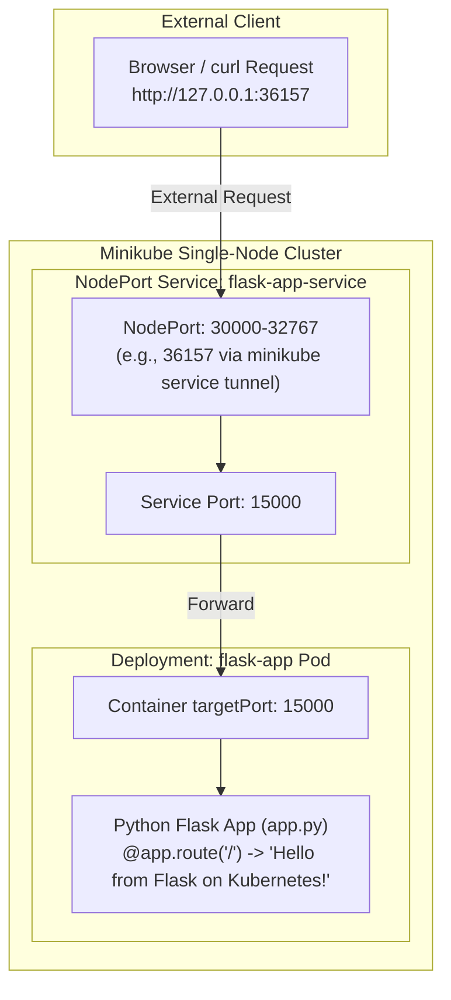

# Exercise 02: Deploy a Flask App on Minikube using kubectl and YAML

## 🎯 Objective
Learn Kubernetes basics using Minikube to set up a single-node cluster and deploy containerized Python applications. In this exercise, you build a custom Python Flask application, package it into a Docker image directly within Minikube's Docker daemon, and deploy it declaratively using Kubernetes Deployments and NodePort Services.

---

## 📚 Prerequisites & Learning Resources
- 📖 [The Illustrated Children’s Guide to Kubernetes (CNCF)](https://www.cncf.io/phippy/the-childrens-illustrated-guide-to-kubernetes/)
- 🎥 [Video: Phippy Guide to Kubernetes](https://www.youtube.com/watch?v=3I9PkvZ80BQ)
- 📖 [Install Minikube Official Guide](https://minikube.sigs.k8s.io/docs/)
- 🎥 [Video: Origins of Kubernetes with Tim Hockin of Google](https://www.youtube.com/watch?v=xSztxKexDXM)
- 🎥 [Video: Keynote: A Vision for Vision (in the era of AI) - Tim Hockin](https://www.youtube.com/watch?v=WqeShpaztZY)

---

## 🛠️ Minikube Cheat Sheet

```bash
# 1. Starting and Stopping Minikube
minikube start                               # Start Minikube with default settings
minikube start --kubernetes-version=v1.28.0  # Start with specific version
minikube stop                                # Stop Minikube without deleting data
minikube delete                              # Delete Minikube cluster

# 2. Checking Status and Information
minikube status                              # Check status of cluster components
kubectl cluster-info                         # Display cluster endpoints

# 3. Accessing Services
minikube service <service-name>              # Open specified service in browser
minikube service list                        # List URLs of all active services
minikube tunnel                              # Create network tunnel for LoadBalancer

# 4. Docker with Minikube
eval $(minikube docker-env)                  # Point host Docker CLI to Minikube daemon
docker build -t my-image .                   # Build image directly inside Minikube
minikube image load my-image                 # Load host Docker image into Minikube

# 5. Debugging and Logs
minikube logs                                # View Minikube system logs
minikube dashboard                           # Launch web management dashboard
minikube ssh                                 # SSH directly into the Minikube VM/node
```

---

## 🏗️ Architecture & Traffic Flow



---

## 📋 Step-by-Step Implementation Guide

### Step 1: Start Minikube
```bash
minikube start
```

---

### Step 2: Create the Flask Application
File: [`app/app.py`](./app/app.py)
```python
from flask import Flask
app = Flask(__name__)

@app.route('/')
def home():
    return "Hello from Flask on Kubernetes!"

if __name__ == '__main__':
    app.run(host='0.0.0.0', port=15000)
```

---

### Step 3: Create the Dockerfile
File: [`app/Dockerfile`](./app/Dockerfile)
```dockerfile
FROM python:3.8-slim
WORKDIR /app
COPY . /app
RUN pip install --no-cache-dir -r requirements.txt
EXPOSE 15000
CMD ["python", "app.py"]
```

---

### Step 4: Build the Docker Image in Minikube's Docker Daemon

To make local images available inside Minikube without pushing to Docker Hub:

- **Linux / macOS / WSL**:
  ```bash
  eval $(minikube docker-env)
  docker build -t flask-app:latest ./app
  ```

- **Windows PowerShell**:
  ```powershell
  & minikube docker-env --shell powershell | Invoke-Expression
  docker build -t flask-app:latest .\app
  ```

- **Alternative (Minikube Native CLI)**:
  ```bash
  minikube image build -t flask-app:latest ./app
  ```

---

### Step 5: Kubernetes Deployment Specification

> [!NOTE]
> **About `imagePullPolicy: Never`**:
> * `Always`: Kubernetes queries the remote registry on every pod start, even if image exists locally.
> * `IfNotPresent`: Kubernetes pulls from registry only if not found locally.
> * `Never`: Kubernetes strictly uses local images from the node's container runtime; it **never** attempts to reach an external registry like Docker Hub.

File: [`manifests/flask-deployment.yaml`](./manifests/flask-deployment.yaml)
```yaml
apiVersion: apps/v1
kind: Deployment
metadata:
  name: flask-app
spec:
  replicas: 1
  selector:
    matchLabels:
      app: flask-app
  template:
    metadata:
      labels:
        app: flask-app
    spec:
      containers:
      - name: flask-app
        image: flask-app:latest
        imagePullPolicy: Never
        ports:
        - containerPort: 15000
```

---

### Step 6: Deploy the Application
```bash
kubectl apply -f manifests/flask-deployment.yaml
```

---

### Step 7: Check Deployment Status
```bash
kubectl get deployments
```
Output:
```text
NAME         READY   UP-TO-DATE   AVAILABLE   AGE
flask-app    1/1     1            1           5s
```

---

### Step 8: Verify Pods Created by Deployment
```bash
kubectl get pods -l app=flask-app
```
Output:
```text
NAME                          READY   STATUS    RESTARTS   AGE
flask-app-b8cd75b6f-tpdpr     1/1     Running   0          5s
```

---

### Step 9: Describe the Deployment
```bash
kubectl describe deployment flask-app
```

---

### Step 10: View Deployment Logs
```bash
kubectl logs -l app=flask-app
```
Output:
```text
 * Serving Flask app 'app'
 * Debug mode: off
 * Running on all addresses (0.0.0.0)
 * Running on http://127.0.0.1:15000
 * Running on http://10.244.0.5:15000
```

---

### Step 11: Check Initial Services
```bash
kubectl get services
```

---

### Step 12: Why `curl http://127.0.0.1:15000` Fails Without a Service
Directly curling `http://127.0.0.1:15000` from the host will result in:
```text
curl: (7) Failed to connect to 127.0.0.1 port 15000: Couldn't connect to server
```
**Reason**: Minikube runs inside an isolated VM/container network. Pod ports are not bound directly to the host machine's `localhost` loopback interface.

---

### Step 13: Expose with a NodePort Service
File: [`manifests/flask-app-all.yaml`](./manifests/flask-app-all.yaml)

```yaml
apiVersion: apps/v1
kind: Deployment
metadata:
  name: flask-app
spec:
  replicas: 1
  selector:
    matchLabels:
      app: flask-app
  template:
    metadata:
      labels:
        app: flask-app
    spec:
      containers:
      - name: flask-app
        image: flask-app:latest
        imagePullPolicy: Never
        ports:
        - containerPort: 15000
---
apiVersion: v1
kind: Service
metadata:
  name: flask-app-service
spec:
  selector:
    app: flask-app
  ports:
  - port: 15000
    targetPort: 15000
  type: NodePort
```

Apply the combined file:
```bash
kubectl apply -f manifests/flask-app-all.yaml
```

Access the application via Minikube's service tunnel:
```bash
minikube service flask-app-service --url
```
Example Output:
```text
http://127.0.0.1:36157
```

In a new terminal window:
```bash
curl http://127.0.0.1:36157
```
Output:
```text
Hello from Flask on Kubernetes!
```

---

## ❓ Q&A Review

| # | Question | Answer |
| :--- | :--- | :--- |
| **Q1** | What is the purpose of `minikube service flask-app-service --url`? | To provide the reachable URL and allocated host port for accessing the service running inside Minikube. |
| **Q2** | What happens when you run `minikube service flask-app-service --url`? | Minikube verifies that the service exists, resolves or bridges the allocated NodePort to a local tunnel URL, and outputs it to the console. |
| **Q3** | Why is `targetPort` used in Kubernetes Service configuration? | To specify the exact port number inside the container where the application process is listening. |
| **Q4** | What is the difference between `port` and `targetPort` in Kubernetes Service configuration? | `port` is the exposed port on the Service cluster IP; `targetPort` is the port inside the backend container. |
| **Q5** | How do you access a Flask application running in Minikube? | Use `minikube service <service-name> --url` or `kubectl port-forward svc/<service-name> 15000:15000`. |
| **Q6** | Why does the terminal need to remain open when using Docker driver on Linux with Minikube? | Because Minikube keeps a live networking bridge tunnel active in that foreground terminal session to route host traffic to the container. |
| **Q7** | What is the benefit of using `--url` flag with `minikube service` command? | It prints the access URL directly into the terminal without automatically launching a GUI desktop browser. |
| **Q8** | What command is used to expose a service in Kubernetes? | `kubectl expose deployment <name> ...` (imperative) or `kubectl apply -f <service.yaml>` (declarative). |
| **Q9** | How does Minikube help in local Kubernetes testing? | It spins up a lightweight, fully functional single-node Kubernetes cluster locally without requiring cloud infrastructure. |
| **Q10** | What is the role of `kubectl` in this setup? | `kubectl` is the official CLI client used to communicate with the `kube-apiserver` to create, query, update, and delete cluster resources. |

---

## 🧹 Cleanup
```bash
# Bash
./scripts/cleanup.sh

# PowerShell
.\scripts\cleanup.ps1
```
