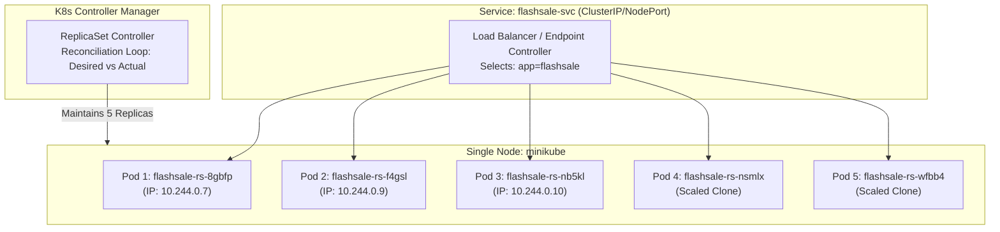

# Exercise 03: Scaling Flask App on Single Node using ReplicaSets

## 🛒 Real-Life Tech Use Case: E-Commerce Flash Sale
During a flash sale on an e-commerce platform (such as **Flipkart’s Big Billion Days** or **Amazon Prime Day**):
- Under normal operating conditions, a product checkout or ordering service might process ~100 requests per minute.
- When the flash sale goes live, incoming traffic spikes instantaneously to **10,000+ requests per minute**.
- If this service runs as a single Pod, CPU/memory limits will be exceeded and the container will crash with 502/504 errors.
- Using a **ReplicaSet**, Kubernetes scales out the service to **5, 10, or 50 identical Pod clones**, automatically distributing customer transactions across them.
- Once the flash sale concludes, the cluster scales down, conserving computing resources and cloud expenditure.

---

## 🎯 Objectives & Key Learnings
1. **Pod Distribution**: Each Pod is an identical, stateless worker running the same application logic.
2. **Resiliency & Self-Healing**: If a Pod crashes or is manually deleted, the ReplicaSet controller detects the discrepancy between *desired state* and *actual state* and immediately provisions a replacement.
3. **Horizontal Scalability**: Rapid scale-out (`kubectl scale`) to absorb unpredictable load spikes.
4. **Traffic Distribution**: Observing how the Service layer distributes `/buy` requests across different Pod hostnames.

---

## 🏗️ Architecture: The ReplicaSet Controller Loop



---

## 💻 Application Specification

### 1. Flask Application ([`app/app.py`](./app/app.py))
- **`/`**: Welcomes customers to the Big Sale and identifies the serving Pod hostname.
- **`/buy?user=123`**: Simulates a flash sale checkout, picks a random item, logs timestamp, and returns `served_by_pod`.
- **`/health`**: Endpoint for Kubernetes `readinessProbe` and `livenessProbe`.

### 2. Dockerfile ([`app/Dockerfile`](./app/Dockerfile))
```dockerfile
FROM python:3.11-slim
WORKDIR /app
COPY . .
RUN pip install --no-cache-dir -r requirements.txt
EXPOSE 5000
CMD ["gunicorn", "-b", "0.0.0.0:5000", "app:app", "--workers", "1", "--threads", "2"]
```

---

## 📋 Step-by-Step Walkthrough

### Step 1: Clean Up Previous Cluster (Optional)
```bash
minikube stop
minikube delete
```

### Step 2: Start Minikube with a Single Node
```bash
minikube start --nodes=1
kubectl get nodes
```

### Step 3: Build Docker Image in Minikube
- **Linux / macOS / WSL**:
  ```bash
  eval $(minikube docker-env)
  docker build -t flashsale:1.0 ./app
  ```
- **Windows PowerShell**:
  ```powershell
  & minikube docker-env --shell powershell | Invoke-Expression
  docker build -t flashsale:1.0 .\app
  ```
- **Direct Minikube CLI**:
  ```bash
  minikube image build -t flashsale:1.0 ./app
  ```

### Step 4: Review ReplicaSet Specification ([`manifests/flashsale-replicaset.yaml`](./manifests/flashsale-replicaset.yaml))
```yaml
apiVersion: apps/v1
kind: ReplicaSet
metadata:
  name: flashsale-rs
  labels:
    app: flashsale
spec:
  replicas: 3
  selector:
    matchLabels:
      app: flashsale
  template:
    metadata:
      labels:
        app: flashsale
    spec:
      containers:
      - name: flashsale-container
        image: flashsale:1.0
        imagePullPolicy: IfNotPresent
        ports:
        - containerPort: 5000
        readinessProbe:
          httpGet:
            path: /health
            port: 5000
          initialDelaySeconds: 2
          periodSeconds: 5
        livenessProbe:
          httpGet:
            path: /health
            port: 5000
          initialDelaySeconds: 10
          periodSeconds: 10
        resources:
          requests:
            cpu: "100m"
            memory: "128Mi"
          limits:
            cpu: "500m"
            memory: "256Mi"
---
apiVersion: v1
kind: Service
metadata:
  name: flashsale-svc
spec:
  type: NodePort
  selector:
    app: flashsale
  ports:
  - name: http
    port: 80
    targetPort: 5000
    nodePort: 30050
```

### Step 5: Apply Manifest
```bash
kubectl apply -f manifests/flashsale-replicaset.yaml
```

### Step 6: Verify Initial Replicas (3 Desired)
```bash
kubectl get rs
kubectl get pods -l app=flashsale
```

### Step 7: Scale the ReplicaSet to 5 Pods
```bash
kubectl scale rs flashsale-rs --replicas=5
```

### Step 8: Verify Scaled ReplicaSet
```bash
kubectl get rs flashsale-rs
```
Output:
```text
NAME           DESIRED   CURRENT   READY   AGE
flashsale-rs   5         5         5       5m
```

### Step 9: Verify 5 Running Pods
```bash
kubectl get pods -l app=flashsale -o wide
```

### Step 10: Test Resiliency & Self-Healing (Delete One Pod)
```bash
# Delete any active pod
kubectl delete pod <pod-name>
```

### Step 11: Confirm Automatic Pod Replacement
```bash
kubectl get pods -l app=flashsale
```
> Notice a brand new Pod with age `< 5s` immediately appeared to maintain the required count of 5!

---

## ❓ Q&A Review

| # | Question | Answer |
| :--- | :--- | :--- |
| **Q1** | What is the initial number of replicas in the ReplicaSet? | **3** |
| **Q2** | How many pods are running after applying the ReplicaSet configuration? | **3** |
| **Q3** | What happens when you scale the ReplicaSet to 5 replicas? | Kubernetes creates **2 additional Pods** to match the desired count (5). The ReplicaSet now maintains 5 running Pods. |
| **Q4** | What happens when you delete one pod? | The ReplicaSet controller detects that actual pods (4) < desired pods (5) and **automatically spins up a new replacement pod**. |
| **Q5** | How does Kubernetes maintain the desired number of replicas? | Via a continuous **reconciliation loop** in the `kube-controller-manager` that compares the live cluster state with the `spec.replicas` desired state in `etcd`. |
| **Q6** | How many nodes are running? | **1** (`minikube`). |
| **Q7** | Where are the pods running with respect to nodes? | All 5 pods run on the same single node (`minikube`), each assigned their own distinct virtual IP on the pod network. |

---

## 🏆 Bonus Challenge: ReplicaSet vs Deployment

While a `ReplicaSet` ensures a specified number of Pod replicas are running, a **`Deployment`** is the higher-level abstraction recommended in production because it provides:
1. **Declarative Rolling Updates**: Zero-downtime updates with automated rollback capabilities.
2. **Version History & Rollouts**: `kubectl rollout undo deployment/flashsale`.
3. **Under the hood**: A Deployment automatically manages its own underlying ReplicaSets!

A production deployment manifest is provided in [`manifests/flashsale-deployment.yaml`](./manifests/flashsale-deployment.yaml):
```bash
kubectl apply -f manifests/flashsale-deployment.yaml
kubectl rollout status deployment/flashsale-deployment
```

---

## 🧹 Cleanup
```bash
# Bash
./scripts/cleanup.sh

# PowerShell
.\scripts\cleanup.ps1
```
