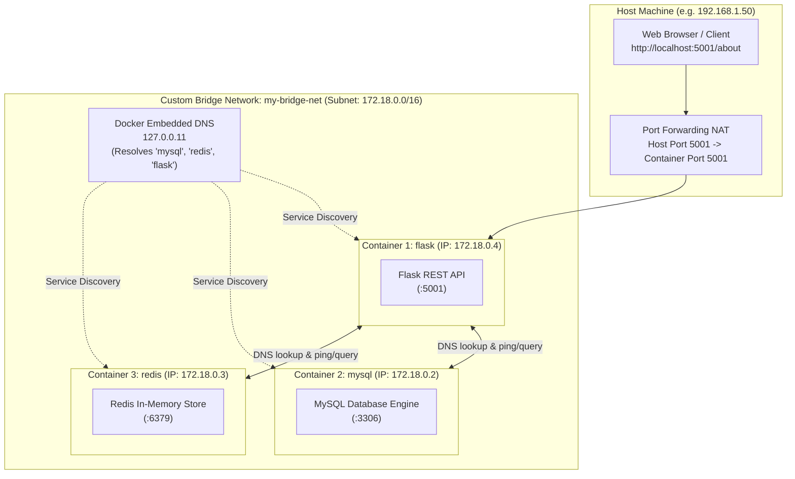

# Exercise 04: Docker Networking with Multiple Containers

## 🎯 Objective
Understand Docker networking fundamentals, custom bridge networks, container DNS resolution, and multi-container communication by connecting three interdependent services:
1. **Python Flask Web Server** (Container 1: `flask`)
2. **MySQL Database** (Container 2: `mysql`)
3. **Redis Cache** (Container 3: `redis`)

---

## 🏗️ Architecture & Network Flow



---

## 📋 Step-by-Step Task Execution

### Task 1: Create a Custom Bridge Network
Create a user-defined bridge network named `my-bridge-net`:
```bash
docker network create --driver bridge my-bridge-net
```
*Output: Network ID hash (e.g. `87c23b491f5994c74e497f4f4f4f4f4f4f4f4`)*

---

### Task 2: Verify the Network
List active Docker networks to confirm creation:
```bash
docker network ls
```
*Output:*
```text
NETWORK ID     NAME            DRIVER    SCOPE
87c23b491f59   my-bridge-net   bridge    local
```

---

### Task 3: Inspect the Network
Inspect the subnet, gateway, IPAM, and connected containers:
```bash
docker network inspect my-bridge-net
```
*Output snippet:*
```json
[
    {
        "Name": "my-bridge-net",
        "Id": "87c23b491f5994c74e497f4f4f4f4f4f4f4f4",
        "Driver": "bridge",
        "Scope": "local",
        "IPAM": {
            "Driver": "default",
            "Config": [
                {
                    "Subnet": "172.18.0.0/16",
                    "Gateway": "172.18.0.1"
                }
            ]
        },
        "Containers": {}
    }
]
```

---

### Task 4: Build and Launch Containers

#### 1. Flask App Code ([`app/app.py`](./app/app.py))
```python
from flask import Flask, jsonify

app = Flask(__name__)

@app.route('/about', methods=['GET'])
def about():
    return jsonify({
        "name": "Simple REST API",
        "version": "1.0",
        "description": "This is a simple REST API built with Flask."
    })

if __name__ == '__main__':
    app.run(host='0.0.0.0', debug=True, port=5001)
```

#### 2. Dockerfile ([`app/Dockerfile`](./app/Dockerfile))
```dockerfile
FROM python:3.9-slim
WORKDIR /app
RUN apt-get update && apt-get install -y --no-install-recommends iputils-ping curl && rm -rf /var/lib/apt/lists/*
COPY requirements.txt .
COPY app.py .
RUN pip install --no-cache-dir -r requirements.txt
EXPOSE 5001
CMD ["python", "app.py"]
```

#### 3. Build the Image
```bash
docker build -t flask-api ./app
```

#### 4. Launch the 3 Containers
```bash
# Container 2: MySQL on my-bridge-net
docker run -d --name mysql --net=my-bridge-net -e MYSQL_ROOT_PASSWORD=rootpassword mysql:latest

# Container 3: Redis on my-bridge-net
docker run -d --name redis --net=my-bridge-net redis:latest

# Container 1: Flask on my-bridge-net with host port mapping
docker run -d --name flask --net=my-bridge-net -p 5001:5001 flask-api
```

---

### Task 5: Test Inter-Container Connectivity

#### 1. Ping MySQL from Flask
```bash
docker exec flask ping -c 3 mysql
```
*Output:*
```text
PING mysql (172.18.0.2) 56(84) bytes of data.
64 bytes from mysql (172.18.0.2): icmp_seq=1 ttl=64 time=0.078 ms
```

#### 2. Ping Redis from Flask
```bash
docker exec flask ping -c 3 redis
```
*Output:*
```text
PING redis (172.18.0.3) 56(84) bytes of data.
64 bytes from redis (172.18.0.3): icmp_seq=1 ttl=64 time=0.078 ms
```

#### 3. Test Flask from Host Browser or cURL
```bash
curl http://localhost:5001/about
```
*Output:*
```json
{
  "description": "This is a simple REST API built with Flask.",
  "name": "Simple REST API",
  "version": "1.0"
}
```

---

### Task 6: Cleanup

```bash
# Stop and remove containers
docker stop mysql redis flask && docker rm mysql redis flask

# Remove the custom network
docker network rm my-bridge-net
```

---

## ❓ Lab Review & Concept Questions

| # | Question | Answer |
| :--- | :--- | :--- |
| **Q1** | **What is the purpose of the `--net` flag in `docker run`?** | The `--net` (or `--network`) flag specifies which network the container connects to upon creation, determining its IP subnet and DNS resolution scope. |
| **Q2** | **How do containers communicate with each other on the same network?** | Containers on a user-defined bridge network communicate automatically using **container names as hostnames** via Docker's built-in embedded DNS server (`127.0.0.11`) or direct container virtual IPs. |
| **Q3** | **What is the difference between a bridge network and a host network?** | • **Bridge Network**: Provides network isolation within a dedicated subnet. Containers communicate via a virtual software bridge (`veth` pairs) and explicit port mapping (`-p`).<br>• **Host Network**: Removes network namespace isolation between container and host; the container attaches directly to the host's networking stack without NAT. |
| **Q4** | **How can you expose a container's port to the host machine?** | By using the publish flag `-p <host_port>:<container_port>` (e.g., `-p 5001:5001`), which creates an `iptables` / Windows NAT forwarding rule. |

---

## 💡 Declarative Alternative: Docker Compose

A [`docker-compose.yml`](./docker-compose.yml) is also included:
```bash
# Spin up all 3 containers and network together:
docker compose up -d

# Verify connectivity:
docker compose exec flask ping -c 3 mysql

# Teardown:
docker compose down -v
```

---

## 🔗 References
- 📄 [Detailed Lab Exercise Document](https://docs.google.com/document/d/1ue5G-sj02E4G9NW5T5ObmsbdMl4LihUS/edit?usp=sharing&ouid=116025589128606060426&rtpof=true&sd=true)
- 🐳 [Docker Bridge Networking Documentation](https://docs.docker.com/network/drivers/bridge/)
