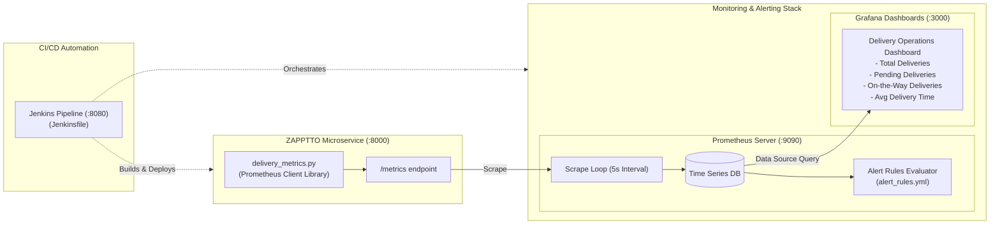

# Exercise 06: Real-Time Operations Monitoring and Alerting (ZAPPTTO)

## 🎯 Objective
As a DevOps Engineer at **ZAPPTTO** (a high-speed delivery service), you are tasked with designing and deploying an end-to-end operational observability platform. The system simulates live delivery operations, exports metrics via Prometheus, visualizes trends on Grafana dashboards, automates deployment through Jenkins CI/CD, and fires automated alerts upon operational SLA breaches.

---

## 🏗️ Architecture & Observability Pipeline



---

## 📊 Prometheus Metric Types Explained

| Metric Type | Used In This Lab | Description | Real-World ZAPPTTO Example |
| :--- | :--- | :--- | :--- |
| **Gauge** | `total_deliveries`, `pending_deliveries`, `on_the_way_deliveries` | A numerical value that can arbitrarily go up or down. | Live number of delivery partners active or orders in transit. |
| **Summary** | `average_delivery_time` | Calculates configurable quantiles over a sliding time window and exposes `_sum` and `_count`. | Tracking order fulfillment latency (e.g., 95th percentile delivery time). |
| **Counter** | *(built-in GC / process metrics)* | A cumulative metric that only increases or resets to zero on restart. | Total completed deliveries count since system boot. |
| **Histogram** | *(alternative to Summary)* | Samples observations into configurable buckets and counts occurrences. | Request duration histograms for SLA compliance. |

---

## 📂 Code Directory Structure
```text
exercise-06/
├── delivery_monitoring/
│   ├── delivery_metrics.py     # Python script simulating live order metrics
│   ├── Dockerfile              # Dockerfile for metric exporter
│   ├── requirements.txt        # prometheus_client dependency
│   ├── prometheus.yml          # Prometheus scrape configuration
│   ├── alert_rules.yml         # Prometheus alerting thresholds
│   └── Jenkinsfile             # Declarative Jenkins CI/CD pipeline
├── docker-compose.yml          # Single-command unified stack
├── scripts/
│   ├── deploy.sh / .ps1        # Automated deployment scripts
│   ├── simulate_alert_spike.py # Script to intentionally trigger critical alerts
│   └── cleanup.sh / .ps1       # Teardown scripts
└── README.md
```

---

## 📋 Step-by-Step Implementation Guide

### Step 1: Write and Run the Delivery Metrics App
File: [`delivery_monitoring/delivery_metrics.py`](./delivery_monitoring/delivery_metrics.py)
```python
from prometheus_client import start_http_server, Summary, Gauge
import random, time

total_deliveries = Gauge("total_deliveries", "Total number of deliveries")
pending_deliveries = Gauge("pending_deliveries", "Number of pending deliveries")
on_the_way_deliveries = Gauge("on_the_way_deliveries", "Number of deliveries on the way")
average_delivery_time = Summary("average_delivery_time", "Average delivery time in seconds")

def simulate_delivery():
    pending = random.randint(10, 20)
    on_the_way = random.randint(5, 20)
    delivered = random.randint(30, 70)
    avg_time = random.uniform(15, 45)
    total = pending + on_the_way + delivered

    total_deliveries.set(total)
    pending_deliveries.set(pending)
    on_the_way_deliveries.set(on_the_way)
    average_delivery_time.observe(avg_time)

if __name__ == "__main__":
    start_http_server(8000, addr="0.0.0.0")
    while True:
        simulate_delivery()
        time.sleep(1)
```

Verify endpoint:
```bash
curl http://localhost:8000/metrics
```

---

### Step 2: Configure Prometheus & Alert Rules
- Configuration: [`delivery_monitoring/prometheus.yml`](./delivery_monitoring/prometheus.yml)
- Rules: [`delivery_monitoring/alert_rules.yml`](./delivery_monitoring/alert_rules.yml)

```yaml
groups:
  - name: delivery_alerts
    rules:
      - alert: HighPendingDeliveries
        expr: pending_deliveries > 10
        for: 15s
        labels:
          severity: warning
        annotations:
          summary: "High pending deliveries"
          description: "Pending deliveries are above 10 for the last 15 seconds."

      - alert: HighAverageDeliveryTime
        expr: (average_delivery_time_sum / average_delivery_time_count) > 30
        for: 15s
        labels:
          severity: critical
        annotations:
          summary: "High average delivery time"
          description: "Average delivery time is above 30 seconds for the last 15 seconds."
```

---

### Step 3: Launch Grafana & Configure Dashboards
1. Open Grafana at [http://localhost:3000](http://localhost:3000) (User: `admin`, Pass: `admin`).
2. Add Prometheus Data Source:
   - URL: `http://prometheus:9090` (Docker network) or `http://host.docker.internal:9090`
3. Create Dashboard Panels:
   - **Panel 1 (Total Deliveries)**: Query `total_deliveries` (Stat / Graph)
   - **Panel 2 (Pending Deliveries)**: Query `pending_deliveries` (Gauge with threshold at 10)
   - **Panel 3 (On-the-Way Deliveries)**: Query `on_the_way_deliveries` (Time Series)
   - **Panel 4 (Average Delivery Time)**: Query `average_delivery_time_sum / average_delivery_time_count`

---

### Step 4: Jenkins CI/CD Automation
Script: [`delivery_monitoring/Jenkinsfile`](./delivery_monitoring/Jenkinsfile)

Retrieve Jenkins initial admin password:
```bash
docker exec jenkins cat /var/jenkins_home/secrets/initialAdminPassword
```
Create a **Pipeline** job in Jenkins, paste the contents of `Jenkinsfile`, and trigger **Build Now**.

---

### Step 5: Simulate Critical Alert Spike
Run [`scripts/simulate_alert_spike.py`](./scripts/simulate_alert_spike.py) to simulate an abnormal surge where pending orders reach 50–100:
```bash
python scripts/simulate_alert_spike.py
```
1. Open Prometheus at [http://localhost:9090/alerts](http://localhost:9090/alerts).
2. Observe `HighPendingDeliveries` transition from **Pending** to **Firing (Active)** after 15 seconds!

---

## 🚀 Quick Start (Docker Compose)
Run the entire platform with one command:
```bash
# Start all 4 services (App, Prometheus, Grafana, Jenkins)
docker compose up -d

# Check status
docker compose ps

# Teardown
docker compose down -v
```

---

## 🧹 Cleanup
```bash
# Bash
./scripts/cleanup.sh

# PowerShell
.\scripts\cleanup.ps1
```
