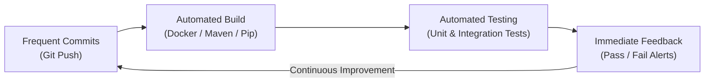
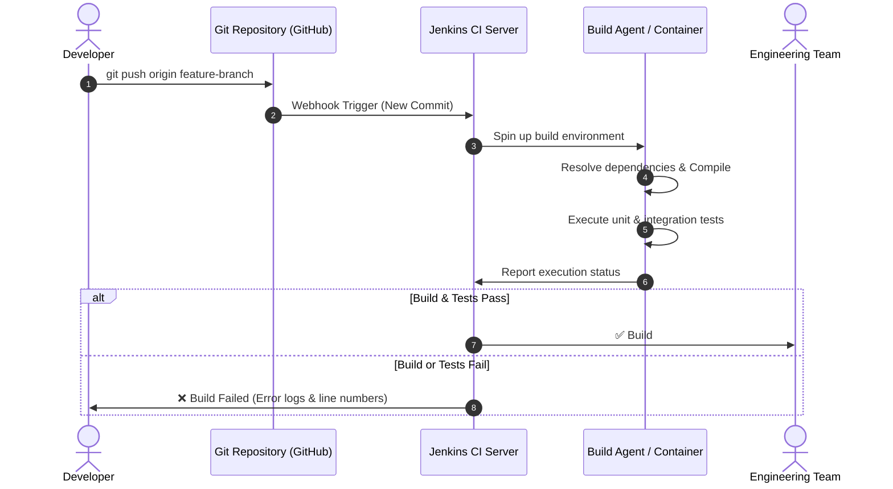
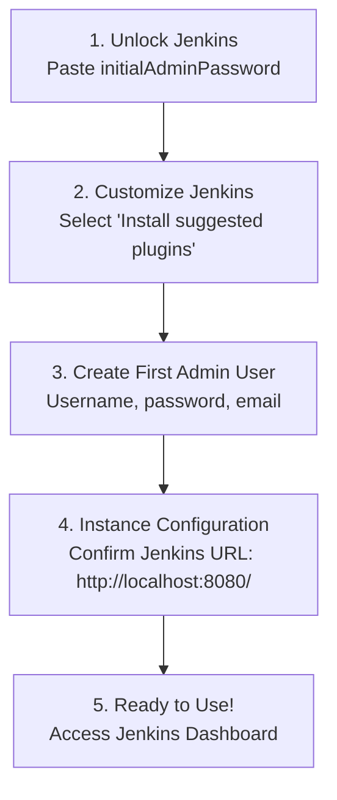

# Exercise 07: Introduction to Continuous Integration (CI) and Jenkins Installation

## 🎯 What is Continuous Integration (CI)?
**Continuous Integration (CI)** is a software engineering practice where developers frequently merge code changes into a central version-controlled repository (multiple times per day). Each integration is verified by an automated build and test pipeline, allowing teams to detect integration issues and bugs early before they reach production.

---

## 🔑 Key Features & Benefits of CI



### Core Benefits
1. **Early Bug Detection**: Bugs identified minutes after commit rather than weeks later in staging.
2. **Improved Collaboration**: Eliminates "merge hell" by integrating code continuously in small increments.
3. **Faster Release Cycles**: Automated testing removes manual QA bottlenecks.
4. **Consistent Code Quality**: Automated linters and test suites enforce standards across all team members.

---

## 🔄 End-to-End CI Workflow



---

## 🛠️ Comparison of Modern CI/CD Platforms

| Tool | Ecosystem / Hosting | Pipeline Syntax | Key Differentiators | Best Suited For |
| :--- | :--- | :--- | :--- | :--- |
| **Jenkins** | Self-hosted / Open Source | Groovy / Declarative `Jenkinsfile` | 1800+ plugins, unmatched extensibility, distributed agents | Enterprise on-prem / flexible custom pipelines |
| **GitHub Actions** | Cloud / Self-hosted Runners | YAML (`.github/workflows/`) | Native GitHub integration, vast Actions marketplace | Teams hosting source code on GitHub |
| **GitLab CI/CD** | Cloud & Self-hosted | YAML (`.gitlab-ci.yml`) | Built-in Auto DevOps, single platform for Git + CI/CD | All-in-one DevOps platform teams |
| **CircleCI** | Cloud & Self-hosted | YAML (`.circleci/config.yml`) | Fast container builds, parallelism, advanced caching | High-speed cloud-native workflows |
| **Azure Pipelines** | Cloud & Hybrid | YAML / Visual Editor | Native Azure integration, cross-platform agents (Win/macOS/Linux) | Teams in the Microsoft & Azure ecosystem |
| **Travis CI** | Cloud | YAML (`.travis.yml`) | Pioneer in open-source CI, easy GitHub hooks | Open-source libraries and small teams |
| **TeamCity** | Self-hosted / Cloud (JetBrains) | Kotlin DSL / Web UI | Advanced build chain analytics, JetBrains tooling synergy | Complex enterprise multi-project builds |
| **Atlassian Bamboo** | Self-hosted | Specs / UI | Deep Jira, Bitbucket, and Confluence traceability | Organizations invested in the Atlassian suite |
| **Drone** | Container-native / Open Source | YAML (`.drone.yml`) | Every step runs inside an isolated ephemeral Docker container | Minimalist, container-first architectures |
| **Spinnaker** | Cloud-native CD | JSON / UI | Advanced deployment strategies (Canary, Blue-Green) across multi-cloud | Large-scale multi-cloud Kubernetes deployment |

---

## 🏗️ Core Jenkins Concepts

- **Job / Project**: A defined task that Jenkins executes (Freestyle, Pipeline, Multi-branch).
- **Build**: A single execution instance of a Job with build numbers and console logs.
- **Pipeline**: An automated suite of stages (Build, Test, Deploy) modeled in a `Jenkinsfile`.
- **Plugins**: Community extensions enabling integrations (Git, Docker, Kubernetes, Slack).
- **Controller (Master) & Agents**: The controller orchestrates schedules; agents execute heavy build jobs.

---

## 🚀 Step-by-Step Jenkins Installation using Docker

### 1. Launch Jenkins Container
```bash
docker run -d --name jenkins-ci \
  -p 8080:8080 \
  -p 50000:50000 \
  -v jenkins_home:/var/jenkins_home \
  -v /var/run/docker.sock:/var/run/docker.sock \
  jenkins/jenkins:lts
```
- **Port 8080**: Web administration dashboard and REST API.
- **Port 50000**: Inbound TCP agent communication port.
- **Volume `jenkins_home`**: Persists configurations, plugins, jobs, and build logs across container restarts.

---

### 2. Retrieve Initial Admin Password
```bash
# Using the automated helper script:
./scripts/get_admin_password.sh jenkins-ci

# Or via manual docker exec:
docker exec jenkins-ci cat /var/jenkins_home/secrets/initialAdminPassword
```
*Example Output:*
```text
060a3736329e4533ab8e4428ffcc9619
```

---

### 3. Web UI Initial Setup Wizard Walkthrough
Open your browser at **[http://localhost:8080/](http://localhost:8080/)**:



1. **Unlock Jenkins**: Paste the 32-character initial password from Step 2.
2. **Customize Jenkins**: Click **"Install suggested plugins"** (installs Git, Pipeline, SSH, etc.).
3. **Create First Admin User**: Fill in your username, password, full name, and email.
4. **Instance Configuration**: Keep `http://localhost:8080/` as the Jenkins URL and click **Save and Finish**.

---

## 🧪 Hands-On Verification: Running a Sample CI Pipeline

A sample test project is provided in [`sample_app/`](./sample_app):
- Application logic: [`sample_app/app.py`](./sample_app/app.py)
- Unit test suite: [`sample_app/test_app.py`](./sample_app/test_app.py)
- CI Pipeline definition: [`sample_app/Jenkinsfile`](./sample_app/Jenkinsfile)

### Create Pipeline Job in Jenkins:
1. In Jenkins Dashboard, click **New Item**.
2. Enter item name: `sample-ci-pipeline`, select **Pipeline**, and click **OK**.
3. Scroll down to the **Pipeline** section:
   - Select **Pipeline script**.
   - Copy and paste the contents of [`sample_app/Jenkinsfile`](./sample_app/Jenkinsfile).
4. Click **Save** and then click **Build Now**.
5. Observe the pipeline stages execute and inspect the **Stage View** and **Console Output** for green checkmarks!

---

## 🧹 Cleanup
```bash
# Bash
./scripts/cleanup.sh

# PowerShell
.\scripts\cleanup.ps1
```
