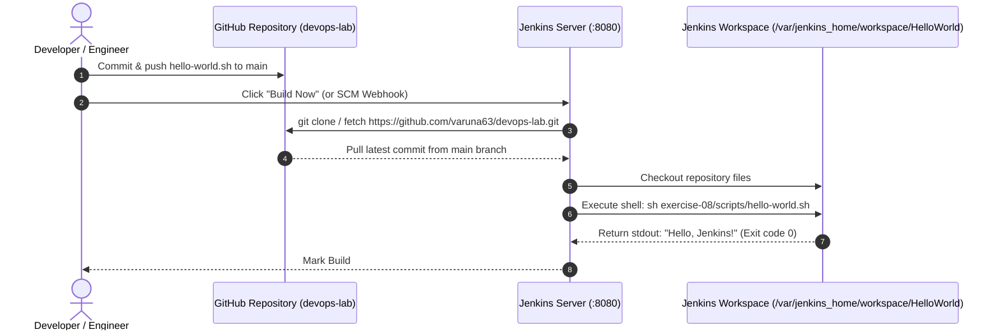

# Exercise 08: Creating "Hello World" Jenkins Job

## 🎯 Objective
Learn how to create, configure, and execute your first **Freestyle Project** in Jenkins integrated with a **GitHub repository**. You will automate code checkout using Git Source Code Management (SCM), trigger a shell build step executing [`hello-world.sh`](./scripts/hello-world.sh), and inspect build logs and console output.

---

## 🏗️ Architecture & Execution Flow



---

## 📜 Script Definition

### 1. Bash Shell Script ([`scripts/hello-world.sh`](./scripts/hello-world.sh))
```bash
#!/bin/bash
set -e

echo "=================================================="
echo "Hello, Jenkins!"
echo "Executed successfully in Jenkins Workspace at: $(pwd)"
echo "Build Timestamp: $(date)"
echo "=================================================="
```

---

## 📋 Step-by-Step Implementation Guide

### Part 1: GitHub Repository & Script Preparation
1. Ensure `hello-world.sh` exists in your repository branch `main`.
2. Repository URL:
   ```text
   https://github.com/varuna63/devops-lab.git
   ```

---

### Part 2: Ensure Jenkins is Running (Prerequisite)
If not already running from Exercise 07, start Jenkins via Docker:
```bash
docker run -d --name jenkins-ci \
  -p 8080:8080 \
  -p 50000:50000 \
  -v jenkins_home:/var/jenkins_home \
  -v /var/run/docker.sock:/var/run/docker.sock \
  jenkins/jenkins:lts
```
Retrieve initial admin password if needed:
```bash
docker exec jenkins-ci cat /var/jenkins_home/secrets/initialAdminPassword
```

---

### Part 3: Configure the "HelloWorld" Job via Jenkins Web UI

#### Step 1: Access Jenkins
- Open your web browser and go to [http://localhost:8080](http://localhost:8080).
- Log in with your admin credentials.

#### Step 2: Create a New Job
1. On the Jenkins home dashboard, click **"New Item"** in the left sidebar.
2. Enter the item name: **`HelloWorld`**.
3. Select **"Freestyle project"**.
4. Click **OK**.

#### Step 3: Configure the Job
- **General**:
  - Description: `Hello World! Jenkins Freestyle job demonstrating GitHub SCM and shell execution.`
- **Source Code Management (SCM)**:
  - Select **Git**.
  - **Repository URL**: `https://github.com/varuna63/devops-lab.git`
  - **Credentials**: None (if public repository) or select your GitHub Personal Access Token (PAT).
  - **Branches to build**: Change `*/master` to `*/main`.
- **Build Steps**:
  - Click **Add build step** → select **Execute shell**.
  - In the Command box, enter:
    ```bash
    sh exercise-08/scripts/hello-world.sh
    ```

#### Step 4: Save and Run the Job
1. Click **Save** at the bottom of the page.
2. On the job dashboard, click **Build Now** in the left menu.
3. Observe **Build #1** appear under the **Build History** panel.

---

### Part 4: Inspect Build Output

Click on **Build #1** → click **Console Output**:

```text
Started by user admin
Running as SYSTEM
Building in workspace /var/jenkins_home/workspace/HelloWorld
The recommended git tool is: NONE
using credential github-pat
 > git rev-parse --resolve-git-dir /var/jenkins_home/workspace/HelloWorld/.git # timeout=10
Fetching changes from the remote Git repository
 > git config remote.origin.url https://github.com/varuna63/devops-lab.git # timeout=10
Fetching upstream changes from https://github.com/varuna63/devops-lab.git
 > git --version # timeout=10
 > git fetch --tags --force --progress -- https://github.com/varuna63/devops-lab.git +refs/heads/*:refs/remotes/origin/* # timeout=10
Checking out Revision f6fac57 (refs/remotes/origin/main)
 > git config core.sparsecheckout # timeout=10
 > git checkout -f f6fac57
Commit message: "Add hello-world.sh"
[HelloWorld] $ /bin/sh -xe /tmp/jenkins1281930102.sh
+ sh exercise-08/scripts/hello-world.sh
==================================================
Hello, Jenkins!
Executed successfully in Jenkins Workspace at: /var/jenkins_home/workspace/HelloWorld
Build Timestamp: Thu Oct 15 21:18:34 UTC 2026
==================================================
Finished: SUCCESS
```

---

## ⚡ Automated Job Creation via REST API

You can also create this job programmatically using Jenkins' REST API and the declarative [`job_config/config.xml`](./job_config/config.xml):

```bash
curl -s -X POST "http://localhost:8080/createItem?name=HelloWorld" \
  --data-binary @job_config/config.xml \
  -H "Content-Type:text/xml" \
  -u "admin:<YOUR_API_TOKEN_OR_PASSWORD>"

# Trigger build
curl -s -X POST "http://localhost:8080/job/HelloWorld/build" \
  -u "admin:<YOUR_API_TOKEN_OR_PASSWORD>"
```

---

## 🔍 Key Troubleshooting Tips

| Issue | Cause | Solution |
| :--- | :--- | :--- |
| **`hello-world.sh: Permission denied`** | Missing executable bit | Add `chmod +x exercise-08/scripts/hello-world.sh` in the build step before executing, or commit it with executable flags. |
| **`Path not found`** | Working directory relative path mismatch | Run `pwd` and `ls -la` in the Execute Shell step to check repository structure. |
| **Branch not found (`master` vs `main`)** | GitHub defaults to `main` | Set **Branch Specifier** to `*/main` in the Git SCM configuration. |
