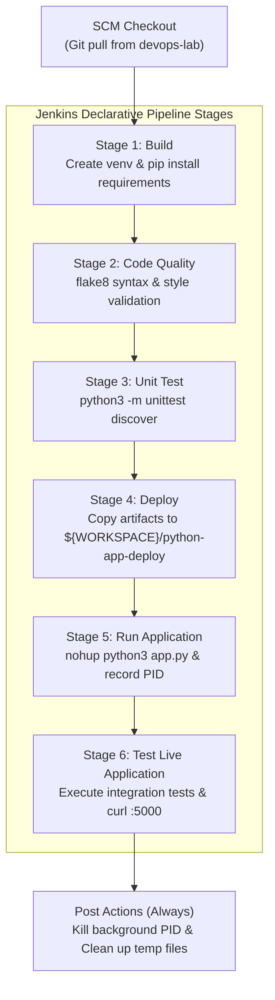

# Exercise 09: Jenkins Multi-Stage Pipeline: Deploying a Python Application

## 🎯 Objective
Create, configure, and execute an automated **multi-stage Jenkins CI/CD pipeline** for a Python Flask application. This exercise demonstrates how to organize enterprise pipelines into sequential stages: **Build**, **Code Quality**, **Unit Testing**, **Mock Deployment**, **Live Runtime Verification**, and **Automated Cleanup**.

---

## 🏗️ Multi-Stage Pipeline Flow



---

## 📂 Application & Pipeline Structure

```text
exercise-09/
├── python-flask-app/
│   ├── app.py                  # Flask web app ('Hello, Jenkins Multi-Stage Pipeline!')
│   ├── requirements.txt        # Dependencies: flask==2.1.2, flake8
│   ├── test_app.py             # unittest test suite testing status code and body
│   └── Jenkinsfile             # Multi-stage declarative pipeline
├── jenkins_agent/
│   └── Dockerfile              # Custom Jenkins image with pre-installed Python 3 & pip
├── scripts/
│   ├── setup_jenkins_python.sh # Helper script to install Python into running Jenkins container
│   └── setup_jenkins_python.ps1# PowerShell helper for Windows
└── README.md
```

---

## 📋 Step-by-Step Implementation Guide

### Step 1: Flask Application ([`python-flask-app/app.py`](./python-flask-app/app.py))
```python
from flask import Flask

app = Flask(__name__)

@app.route("/")
def home():
    return "Hello, Jenkins Multi-Stage Pipeline!"

if __name__ == "__main__":
    app.run(host="0.0.0.0", port=5000, debug=True)
```

---

### Step 2: Unit Test Suite ([`python-flask-app/test_app.py`](./python-flask-app/test_app.py))
```python
import unittest
from app import app

class TestApp(unittest.TestCase):
    def test_home(self):
        tester = app.test_client()
        response = tester.get("/")
        content = response.data.decode("utf-8")
        print(f"\n[TEST LOG] Response: {content}")
        self.assertEqual(response.status_code, 200)
        self.assertEqual(content, "Hello, Jenkins Multi-Stage Pipeline!")

if __name__ == "__main__":
    unittest.main()
```

---

### Step 3: Multi-Stage Jenkinsfile ([`python-flask-app/Jenkinsfile`](./python-flask-app/Jenkinsfile))

```groovy
pipeline {
    agent any

    environment {
        DEPLOY_DIR = "${WORKSPACE}/python-app-deploy"
        PID_FILE   = "${WORKSPACE}/python-app-deploy/app.pid"
    }

    stages {
        stage('Build') {
            steps {
                echo '[*] Stage 1: Creating virtual environment and installing dependencies...'
                sh '''
                    python3 -m venv venv || virtualenv venv
                    . venv/bin/activate
                    pip install --upgrade pip
                    pip install -r exercise-09/python-flask-app/requirements.txt || pip install -r requirements.txt
                '''
            }
        }

        stage('Code Quality') {
            steps {
                echo '[*] Stage 2: Running code quality analysis (flake8)...'
                sh '''
                    . venv/bin/activate
                    flake8 exercise-09/python-flask-app/app.py --max-line-length=120 || true
                '''
            }
        }

        stage('Unit Test') {
            steps {
                echo '[*] Stage 3: Running unit tests with unittest...'
                sh '''
                    . venv/bin/activate
                    cd exercise-09/python-flask-app || true
                    python3 -m unittest discover -s . -v
                '''
            }
        }

        stage('Deploy') {
            steps {
                echo '[*] Stage 4: Deploying application to mock deployment directory...'
                sh '''
                    mkdir -p ${DEPLOY_DIR}
                    cp exercise-09/python-flask-app/app.py ${DEPLOY_DIR}/ || cp app.py ${DEPLOY_DIR}/
                    cp exercise-09/python-flask-app/requirements.txt ${DEPLOY_DIR}/ || cp requirements.txt ${DEPLOY_DIR}/
                    echo "[+] Artifacts deployed to ${DEPLOY_DIR}"
                '''
            }
        }

        stage('Run Application') {
            steps {
                echo '[*] Stage 5: Starting Flask application in background...'
                sh '''
                    . venv/bin/activate
                    nohup python3 ${DEPLOY_DIR}/app.py > ${DEPLOY_DIR}/app.log 2>&1 &
                    echo $! > ${PID_FILE}
                    echo "[+] Application started with PID: $(cat ${PID_FILE})"
                    sleep 3
                '''
            }
        }

        stage('Test Live Application') {
            steps {
                echo '[*] Stage 6: Testing deployed application endpoint...'
                sh '''
                    . venv/bin/activate
                    cd exercise-09/python-flask-app || true
                    python3 test_app.py
                    curl -s http://localhost:5000/ || true
                '''
            }
        }
    }

    post {
        always {
            echo '[*] Cleaning up background application process...'
            sh '''
                if [ -f "${PID_FILE}" ]; then
                    APP_PID=$(cat ${PID_FILE})
                    echo "[*] Terminating process PID ${APP_PID}..."
                    kill ${APP_PID} 2>/dev/null || true
                    rm -f ${PID_FILE}
                fi
            '''
        }
        success {
            echo 'Multi-Stage CI/CD Pipeline PASSED Successfully!'
        }
        failure {
            echo 'Multi-Stage CI/CD Pipeline FAILED.'
        }
    }
}
```

---

### Step 4: Configure the Pipeline Job in Jenkins
1. Open Jenkins at [http://localhost:8080](http://localhost:8080).
2. Click **New Item** → Name: `Python-MultiStage-Pipeline` → Select **Pipeline** → Click **OK**.
3. Under the **Pipeline** configuration section:
   - **Definition**: Select **Pipeline script from SCM**.
   - **SCM**: Select **Git**.
   - **Repository URL**: `https://github.com/varuna63/devops-lab.git`
   - **Branch Specifier**: `*/main`
   - **Script Path**: `exercise-09/python-flask-app/Jenkinsfile`
4. Click **Save** and trigger **Build Now**.

---

## ⚠️ Step 8: Resolving Missing Python Dependencies in Jenkins Container

The official `jenkins/jenkins:lts` base image does not ship with Python or pip installed. If executed without preparation, the pipeline will fail with `python3: command not found`.

### Solution A: Install into Running Container (Quick Fix)
Run the automated helper script:
```bash
# Linux / macOS / WSL:
./scripts/setup_jenkins_python.sh jenkins-ci

# Windows PowerShell:
.\scripts\setup_jenkins_python.ps1 -Container "jenkins-ci"
```

Or manually via `docker exec`:
```bash
docker exec -it -u root jenkins-ci bash
apt-get update
apt-get install -y python3 python3-pip python3-venv python3-flask
exit
```

### Solution B: Build a Custom Jenkins Image
Use the provided [`jenkins_agent/Dockerfile`](./jenkins_agent/Dockerfile):
```bash
docker build -t jenkins-python:latest ./jenkins_agent
```

---

## 📊 Expected Console Output

```text
[Pipeline] stage (Build)
Creating virtual environment and installing dependencies...
[Pipeline] stage (Code Quality)
Running code quality checks...
[Pipeline] stage (Unit Test)
Running tests...
test_home (test_app.TestApp) ... 
[TEST LOG] Response: Hello, Jenkins Multi-Stage Pipeline!
ok
----------------------------------------------------------------------
Ran 1 test in 0.004s
OK
[Pipeline] stage (Deploy)
Deploying application...
[+] Artifacts deployed to /var/jenkins_home/workspace/Python-MultiStage-Pipeline/python-app-deploy
[Pipeline] stage (Run Application)
Running application...
[+] Application started with PID: 5064
[Pipeline] stage (Test Live Application)
Testing application...
Ran 1 test in 0.003s
OK
Hello, Jenkins Multi-Stage Pipeline!
[Pipeline] stage (Declarative: Post Actions)
[*] Cleaning up background application process...
[*] Terminating process PID 5064...
Multi-Stage CI/CD Pipeline PASSED Successfully!
Finished: SUCCESS
```
